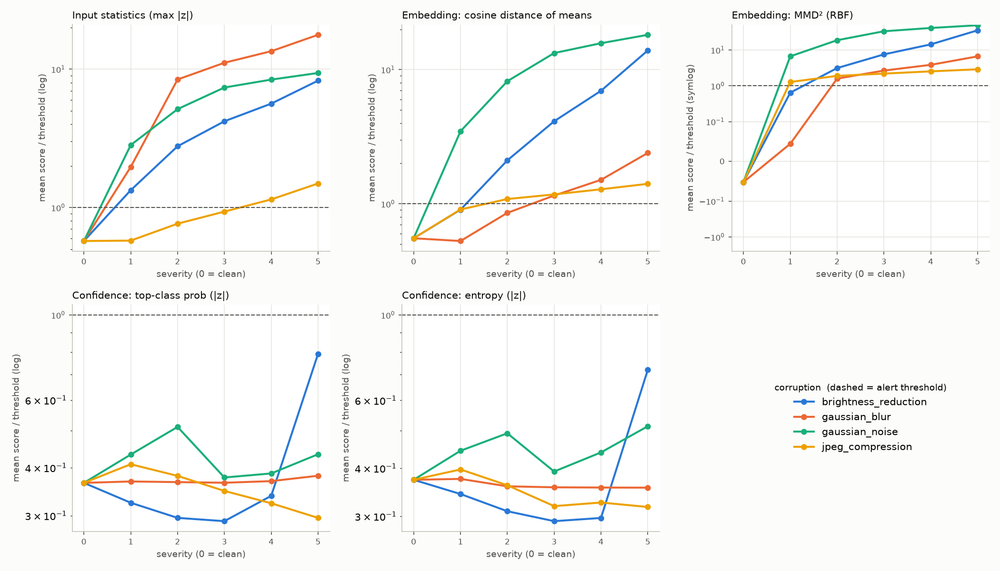
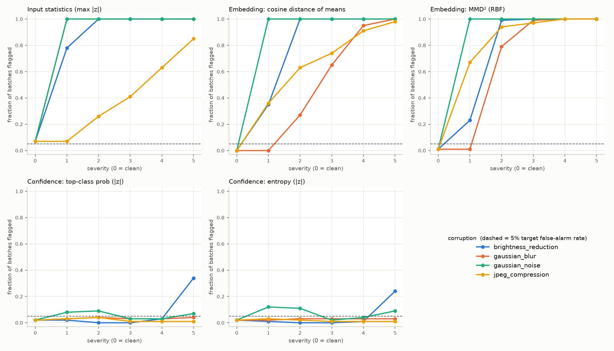
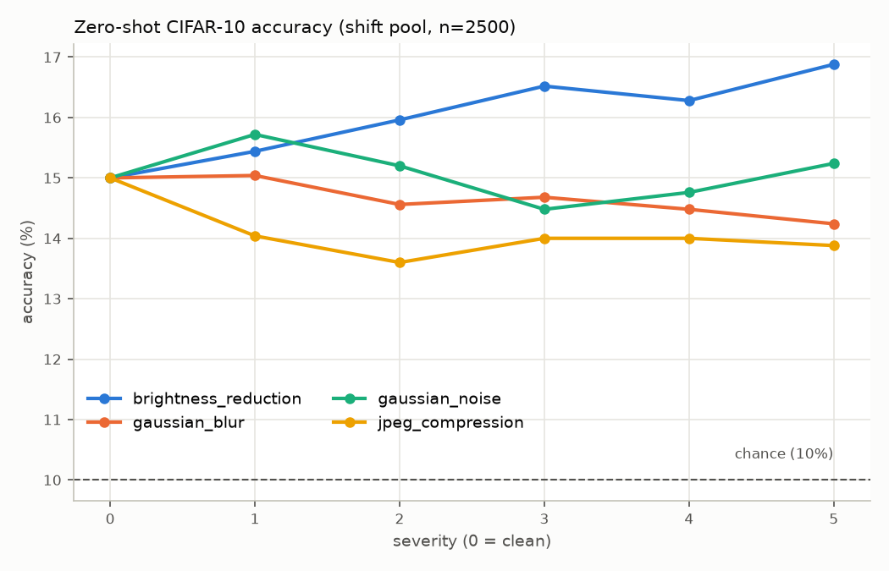

# Vision Language Model

A CLIP-style vision-language model built from scratch: a Vision Transformer image encoder and a text encoder, trained together with a contrastive loss on Flickr30k image-caption pairs.

No pretrained CLIP weights. No fine-tuning on top of an existing model. The patch embedding, the attention, the transformer blocks, the contrastive loss, the training loop — all of it was written from scratch.

I'd previously built a [speech-language model](https://github.com/kirangowda3101/Speech-Language-Model) from scratch, which meant implementing transformers (RoPE, SwiGLU, attention, the training loop) for audio and text. This project is the vision counterpart to that one — the same from-scratch approach, applied to images and text instead of speech and text. Together they're meant to show the same underlying skill (building transformers from the ground up) across two different modalities.

**Code:** [GitHub](https://github.com/kirangowda3101/Vision-Language-Model)
**Model weights:** [HuggingFace](https://huggingface.co/kirangowda3101/vision-language-model) (257MB, inference-ready)

---

## The core idea

An image and a sentence describing it don't look anything alike as raw data — one is a grid of pixels, the other is a sequence of words. CLIP's trick is to train two separate encoders, one for each, and force both of them to land in the same vector space. A picture of a dog and the caption "a photo of a dog" should end up as two vectors that point in almost the same direction.

Training does this with a contrastive loss: for every batch of (image, caption) pairs, pull the correct pairs' embeddings together and push every other combination in the batch apart. Do that enough times and the model learns a shared space where "similar meaning" means "close together," regardless of which side (image or text) a vector came from.

Once you have that space, two things fall out for free. Text-to-image search: embed a query like "a dog on a beach," compare it against a set of pre-embedded images, and return whichever ones are closest. Zero-shot classification: embed a handful of candidate labels ("a cat," "a car," "a building"), embed an image, and see which label it's closest to — without ever training on those specific labels.

---

## Architecture

**Image side.** The image is cut into non-overlapping 16x16 patches and each patch is linearly projected into the embedding space — done in one shot with a single `Conv2d(kernel_size=16, stride=16)`, which is mathematically the same operation as flattening each patch and multiplying by a weight matrix. A learnable CLS token is prepended to the sequence of patch embeddings, and learnable position embeddings are added so the model knows where each patch sits in the image. The sequence passes through a stack of pre-norm transformer blocks with multi-head self-attention written from scratch (no `nn.MultiheadAttention`). After the last block, the CLS token's output is taken as the image's summary and projected into the shared 256-dim space.

**Text side.** A caption is tokenized with GPT-2's byte-pair tokenizer, embedded, given the same kind of learnable position embeddings, and run through the identical transformer block architecture used on the image side — attention doesn't care whether the tokens it's mixing came from patches or words. The last token's output is taken as the caption's summary and projected into the same 256-dim space.

| Setting | Value |
| --- | --- |
| Image size | 224 x 224 |
| Patch size | 16 x 16 |
| Embedding dim | 512 |
| Attention heads | 8 |
| Transformer depth | 6 blocks (each side) |
| Output (shared) dim | 256 |
| Text vocabulary | 50,257 (GPT-2 BPE) |
| Max caption length | 32 tokens |

---

## Training

Trained on Flickr30k — about 31,000 images, each with 5 human-written captions — loaded through HuggingFace `datasets`. One caption per image is used per epoch; the original loader (`nlphuji/flickr30k`) stopped working with newer versions of the `datasets` library, so training switched to a parquet-based mirror (`Mozilla/flickr30k-transformed-captions`) that doesn't need a custom dataset script.

**Optimizer:** AdamW, learning rate 1e-4, weight decay 0.1. Standard image/text contrastive setup: each GPU (or the single process, in the non-distributed case) computes the loss over its own batch, treating the diagonal of the image-caption similarity grid as the correct matches and everything off-diagonal as negatives.

**Infrastructure:** a single V100 on Northeastern's Explorer HPC cluster, managed with SLURM. Multi-GPU training via DDP was implemented and validated on 2 GPUs, though the actual training runs used a single GPU. A few things were necessary to make this workable on a cluster with an 8-hour job limit:

- **Self-chaining.** A SLURM job pre-submits its own successor (as a dependency) before it starts training, then cancels that pending job afterward if training turned out to be fully complete. This lets a run continue unattended across as many jobs as it needs.
- **Checkpoint resume.** Checkpoints save the full training state — model weights, optimizer state, epoch, and global step — not just weights. Restoring only weights and starting AdamW's momentum from zero on every resume would produce a burst of bad updates after every job boundary; saving optimizer state avoids that.
- **Atomic checkpoint writes.** Checkpoints are written to a temp file and then renamed into place, so a job killed mid-write (which is the normal way these jobs end, at the time limit) can't leave a corrupted checkpoint behind.

---

## The batch size experiment

The first full training run used batch size 16, and the results were weak. Zero-shot accuracy on CIFAR-10 came out to 16.2% (random guessing is 10%, so the model had learned something, but not much). Running the text-to-image search demo made the problem visible directly: similarity scores across different images were all bunched together, with no real gap between good and bad matches, and the top results for a query like "a dog" were a mix of dogs and things that clearly weren't dogs.

The cause is how contrastive learning actually works. Each image in a batch is only ever contrasted against the *other captions in that same batch* — those are its negatives. Batch size 16 means 15 negatives per image. That's not enough variety for the loss to force the model to draw sharp distinctions; with so few things to tell apart, "close enough" gets rewarded too easily.

Retraining with batch size 64 (63 negatives per image, same everything else) changed this substantially:

| | Batch 16 | Batch 64 |
| --- | --- | --- |
| Negatives per image | 15 | 63 |
| Zero-shot CIFAR-10 accuracy | 16.2% | 23.6% |
| "a dog" search results | mixed, several wrong | all 5 results were dogs |
| Similarity scores | bunched, no clear gap | confident matches ~0.66, uncertain ones ~0.49 |

The batch-64 model didn't just score higher — it started behaving the way a contrastive model is supposed to: confident when it's right, and visibly less confident when it's not, instead of returning everything with roughly the same score.

---

## Results

Text-to-image search (batch-64 model) is noticeably better on concepts that show up a lot in Flickr30k — dogs, people doing things outdoors, groups of people in a scene — and weaker on things that are rarer in that dataset, like bicycles. Two real queries side by side make this concrete: one it's good at, one it isn't.

Query: `"a dog"` — top 5 results, all of them actually dogs:

```
0.656  A little tan dog with large ears running through the grass.
0.638  Two brown dogs are creating large splashes as they run in a river.
0.637  A white dog is resting its head on a tiled floor with its eyes open.
0.564  A light brown dog runs down a path happily.
0.537  A yellow lab standing next to a man.
```

Query: `"a man on a bicycle"` — top result:

```
0.491  A young gymnast jumps high in the air while performing on a balance beam.
```

No bicycle, no man — a wrong match. But look at the score: 0.491, well below the 0.656–0.537 range for the dog query. That gap is the model telling you it doesn't have a good match, not confidently getting it wrong. A low, flat score when the model is unsure is the correct behavior for a contrastive model, not a bug.

Zero-shot on CIFAR-10 test images (never seen during training, and CIFAR-10 itself was never used for training — only for evaluation): **23.6%** against a 10% random baseline across the 10 classes. This is a real, if modest, out-of-domain transfer result: the model was trained entirely on Flickr30k photos and captions, and is being asked to classify a completely different, much lower-resolution dataset it has never encountered.

---

## What it can't do

This is a small-scale project by design, and the results should be read that way. Flickr30k is about 31,000 image-caption pairs; the original CLIP paper trained on roughly 400 million. The gap between 23.6% and something closer to CLIP's reported zero-shot numbers is a data and compute limitation, not evidence that the architecture or training loop is broken — the batch size experiment above is a pretty direct demonstration that the training mechanics work correctly and respond to the things that should improve them.

Concretely:

- It's strong at matching within the distribution it was trained on (photo-style Flickr images with natural-language captions) and weaker at generalizing to genuinely out-of-domain images.
- Padding tokens in captions are not masked out of attention. Every caption is padded to a fixed 32 tokens, and the model attends over the padding along with the real tokens. This is a deliberate simplification, not an oversight — it costs some efficiency and precision, but at this sequence length and scale it didn't stop the model from learning.
- Rare concepts in the training data are underrepresented in the model's vocabulary of "things it recognizes well," which shows up directly in weaker search results for them.

---

## Drift detection

A deployed model only knows the distribution it was evaluated on. This section adds monitoring that compares incoming batches against a clean reference window and raises an alert when they stop looking alike, plus an offline experiment that measures how well each signal works on synthetic CIFAR-10-C-style corruptions.

These experiments use the checkpoint published on Hugging Face (weights/best.pt).

### Method

**Data split.** CIFAR-10 test indices 0-499 (the zero-shot evaluation subset) are not used for drift work. A seeded permutation of indices 500-9999 is cut into four disjoint pools, so no image plays two roles:

| Pool | Images | Used for |
| --- | --- | --- |
| reference | 2,000 | the clean reference window |
| calibration | 2,500 | clean batches for setting alert thresholds |
| held-out | 2,500 | separate clean batches for measuring false alarms |
| shift | 2,500 | images that get corrupted (and their clean versions = severity 0) |

**Per-image features** (`drift_metrics.py`):
- Input statistics, computed on the native 32x32 image: brightness (mean grayscale), contrast (grayscale std), and sharpness (variance of the 4-neighbour Laplacian over interior pixels). Computing them after the 224x224 bilinear upsample would mostly measure the interpolation.
- Image embedding: the L2-normalized 256-d image-encoder output.
- Zero-shot confidence: `softmax(logit_scale * cosine)` over the 10 `"a photo of a <class>"` prompts, using the learned `logit_scale` (23.16) the model was trained with. From that, top-class probability and entropy. (The Gradio demo shows a softmax over *unscaled* cosines, which is close to uniform and makes entropy nearly constant.)

**Per-batch drift scores** (batch size 100; every score is oriented so larger = more drift):

| Signal | Score |
| --- | --- |
| Input stats | max over brightness, contrast, log-sharpness of \|batch mean - ref mean\| / (ref std / sqrt(100)) |
| Embedding cosine | 1 - cos(mean batch embedding, mean reference embedding) |
| Embedding MMD | unbiased MMD² with an RBF kernel; bandwidth = median pairwise distance in the reference (1.176), frozen. A 500-permutation p-value is also computed for every batch. |
| Confidence top-prob | \|z\| of the batch's mean top-class probability vs the reference |
| Confidence entropy | \|z\| of the batch's mean entropy vs the reference |

The permutation test builds the pooled kernel matrix K once and evaluates all permutations together: with a 0/1 assignment matrix A, the within-batch, cross, and within-reference kernel sums all come out of `K @ A`, so 500 permutations cost one matrix multiply (about 0.06 s per batch on a laptop CPU).

**Thresholds.** For each signal, the alert threshold is the 95th percentile of its score over 500 clean batches drawn from the calibration pool (alert when score > threshold). The false-alarm rate is then measured on 500 batches from the separate held-out pool. Each batch is 100 distinct images sampled uniformly from its pool. Batches drawn from the same 2,500-image pool overlap, so they aren't independent.

**Corruptions** (`corruptions.py`), applied at 32x32 before preprocessing. Severity parameters for noise, blur, and JPEG are the ones in the CIFAR-10-C generation script (`make_cifar_c.py`, Hendrycks & Dietterich 2019). CIFAR-10-C's brightness corruption *adds* to the HSV value channel; here the same offsets are subtracted to simulate under-exposure.

| Corruption | Severity 1 → 5 |
| --- | --- |
| brightness_reduction (HSV V offset) | 0.05, 0.1, 0.15, 0.2, 0.3 |
| gaussian_blur (sigma, px) | 0.4, 0.6, 0.7, 0.8, 1.0 |
| gaussian_noise (std, [0,1] scale) | 0.04, 0.06, 0.08, 0.09, 0.10 |
| jpeg_compression (quality) | 80, 65, 58, 50, 40 |

For every condition, the same 100 batch index sets into the shift pool are scored (a paired design), so differences between severities come from the corruption, not from which images were drawn. Seeds are fixed throughout (`--seed 0`); per-image noise is seeded by (seed, corruption, severity, image index).

### Results

All numbers come from a single run, `python drift_experiment.py --checkpoint weights/best.pt` (MPS on an Apple-silicon laptop, 470 s). Raw output: `results/drift/drift_results.json`, log: `results/drift/run.log`.

**False alarms on clean data** (target 5%):

| Signal | Threshold | FAR, calibration batches | FAR, held-out clean batches (95% Wilson CI) |
| --- | --- | --- | --- |
| Input stats | 2.421 | 4.8% | 6.2% (31/500; 4.4–8.7%) |
| Emb. cosine | 0.01925 | 4.8% | 2.8% (14/500; 1.7–4.6%) |
| Emb. MMD | 0.00269 | 4.8% | 3.6% (18/500; 2.3–5.6%) |
| Conf. top-prob | 2.236 | 4.8% | 6.6% (33/500; 4.7–9.1%) |
| Conf. entropy | 2.213 | 4.8% | 7.8% (39/500; 5.8–10.5%) |
| MMD p < 0.05 (uncalibrated) | p < 0.05 | 7.2% | 5.6% (3.9–8.0%) |

The calibrated thresholds don't hold exactly 5% on new clean data. Held-out false-alarm rates range from 2.8% (embedding cosine) to 7.8% (confidence entropy), and for those two signals the 95% interval excludes 5%. The Wilson intervals assume independent batches, which overlapping batches aren't, so the true uncertainty is wider. The pools themselves differ slightly (for example, clean accuracy is 13.0% on the held-out pool and 15.0% on the shift pool), and a threshold fitted to one finite pool inherits that pool's quirks. The clean shift pool (severity 0 below) gives a third look: 7% / 0% / 1% / 2% / 2%.

**Detection rate** (fraction of 100 batches flagged) **and zero-shot accuracy** (on all 2,500 shift-pool images):

| Corruption | Sev. | Param | Accuracy | Input stats | Emb. cosine | Emb. MMD | Conf. top-prob | Conf. entropy |
| --- | --- | --- | --- | --- | --- | --- | --- | --- |
| none (clean shift pool) | 0 | – | 15.0% | 7% | 0% | 1% | 2% | 2% |
| brightness_reduction | 1 | 0.05 | 15.4% | 78% | 35% | 23% | 2% | 1% |
| brightness_reduction | 2 | 0.1 | 16.0% | 100% | 100% | 99% | 0% | 0% |
| brightness_reduction | 3 | 0.15 | 16.5% | 100% | 100% | 100% | 0% | 0% |
| brightness_reduction | 4 | 0.2 | 16.3% | 100% | 100% | 100% | 3% | 1% |
| brightness_reduction | 5 | 0.3 | 16.9% | 100% | 100% | 100% | 34% | 24% |
| gaussian_blur | 1 | 0.4 | 15.0% | 100% | 0% | 1% | 3% | 2% |
| gaussian_blur | 2 | 0.6 | 14.6% | 100% | 27% | 79% | 4% | 3% |
| gaussian_blur | 3 | 0.7 | 14.7% | 100% | 65% | 99% | 3% | 3% |
| gaussian_blur | 4 | 0.8 | 14.5% | 100% | 95% | 100% | 3% | 3% |
| gaussian_blur | 5 | 1.0 | 14.2% | 100% | 100% | 100% | 4% | 3% |
| gaussian_noise | 1 | 0.04 | 15.7% | 100% | 100% | 100% | 8% | 12% |
| gaussian_noise | 2 | 0.06 | 15.2% | 100% | 100% | 100% | 9% | 11% |
| gaussian_noise | 3 | 0.08 | 14.5% | 100% | 100% | 100% | 3% | 2% |
| gaussian_noise | 4 | 0.09 | 14.8% | 100% | 100% | 100% | 3% | 4% |
| gaussian_noise | 5 | 0.1 | 15.2% | 100% | 100% | 100% | 7% | 9% |
| jpeg_compression | 1 | 80 | 14.0% | 7% | 36% | 67% | 3% | 3% |
| jpeg_compression | 2 | 65 | 13.6% | 26% | 63% | 94% | 4% | 2% |
| jpeg_compression | 3 | 58 | 14.0% | 41% | 74% | 97% | 1% | 1% |
| jpeg_compression | 4 | 50 | 14.0% | 63% | 91% | 100% | 1% | 1% |
| jpeg_compression | 5 | 40 | 13.9% | 85% | 98% | 100% | 1% | 1% |





What the run shows:

- **Embedding MMD is the strongest single detector.** It flags at least 79% of batches at severity ≥ 2 for every corruption, and 100% at every noise severity. Where it misses: blur at severity 1 (1%, indistinguishable from clean), brightness at severity 1 (23%), and JPEG at severity 1 (67%).
- **Embedding cosine-of-means is consistently weaker than MMD** on the same embeddings, e.g. blur severity 2: 27% vs 79%. It only sees a shift in the mean, while MMD compares whole distributions.
- **Input statistics catch pixel-level changes but are blind to JPEG.** Brightness, blur, and noise change the brightness or Laplacian variance directly, so they're flagged at 78-100% from severity 1. JPEG at quality 80 barely moves these statistics (7%, the same as clean), and even at quality 40 detection reaches only 85%.
- **Confidence signals mostly fail.** For blur, JPEG, and noise, detection stays between 1% and 12% at every severity (the highest is noise at severity 1-2, at 8-12%). For brightness it's 0-3% until severity 5 (34% top-prob / 24% entropy). Mean top-class probability moves very little under any corruption (0.612-0.663 vs 0.657 on the clean shift pool), even when the embeddings have clearly moved.
- **Accuracy barely drops, so there's little accuracy drop to track.** Accuracy on the shift pool is 15.0% clean and stays between 13.6% and 16.9% under every corruption. Brightness reduction *raises* accuracy at every severity (to 16.9% at severity 5). For reference, the binomial standard error of a single accuracy estimate on 2,500 images at 15% is about 0.7 percentage points. A model this close to chance has little accuracy left to lose.

**Do drift scores track the accuracy drop?** Spearman rank correlation between drift score and accuracy drop (clean shift-pool accuracy minus condition accuracy):

| Signal | All 21 conditions | brightness | blur | noise | JPEG | Batch level (2,100 batches) |
| --- | --- | --- | --- | --- | --- | --- |
| Input stats | -0.24 | -0.94 | +0.89 | +0.14 | +0.64 | -0.07 |
| Emb. cosine | -0.38 | -0.94 | +0.94 | +0.14 | +0.64 | -0.14 |
| Emb. MMD | -0.38 | -0.94 | +0.89 | +0.14 | +0.64 | -0.13 |
| Conf. top-prob | -0.07 | -0.03 | +0.66 | -0.60 | -0.29 | 0.00 |
| Conf. entropy | -0.11 | +0.14 | -0.94 | -0.66 | -0.58 | +0.01 |

Per-corruption columns have only 6 points each (severities 0-5), so a single swapped pair moves them a lot. Across all conditions, every signal has a weak *negative* correlation, and at the batch level the correlations are within ±0.14 of zero. The embedding and input-statistic scores generally rise with severity (the plot shows a few non-monotone steps at low severity), but accuracy doesn't fall with them (it rises for brightness). So for this checkpoint, **drift scores cannot be used as a proxy for accuracy loss.** They detect that the inputs changed, not that the model got worse.

### Monitoring in the serving path

`drift_monitor.py` hooks into `classify_image` in `app.py` and `app_space.py`. It buffers each classified upload (its 32x32 input statistics and the embedding the model already computed) and, every `DRIFT_WINDOW_SIZE` images (default 100), scores the window with the same `DriftReference.score` code the experiment used. It then exports Prometheus metrics on `METRICS_PORT` (default 8000):

| Metric | Meaning |
| --- | --- |
| `clip_drift_score{signal}` | last window's score |
| `clip_drift_threshold{signal}` | calibrated threshold |
| `clip_drift_alert{signal}` | 1 if score > threshold |
| `clip_drift_mmd_pvalue` | permutation p-value (200 permutations) |
| `clip_drift_component{component}` | per-statistic z-scores and batch means |
| `clip_drift_window_fill`, `clip_drift_windows_total`, `clip_drift_images_total`, `clip_drift_last_window_timestamp_seconds` | progress / staleness |

The demo classifies against a different label set than CIFAR-10, so confidence is computed over the app's labels, and the monitor re-calibrates every threshold at startup on the stored calibration pool for its label set and window size (about 1 s). It needs `drift_reference.npz`, written by the experiment; without it the app runs unmonitored and prints a notice. `monitoring/prometheus.yml` is a minimal scrape config, and `monitoring/grafana_alert_rules.yaml` is an example Grafana alert rule (file provisioning). It fires per signal when `clip_drift_score / clip_drift_threshold > 1` holds for 10 minutes, and a second rule fires when no window has been scored for an hour. The Grafana rule has not been tested against a running Grafana instance; the metrics endpoint was tested by scraping it.

### Limitations

- **The serving reference doesn't match real traffic.** The reference is CIFAR-10 test images; uploads to the demo are arbitrary photos, so the monitor will flag them as drift almost immediately. For real use, the reference should be a sample of known-good production traffic. The monitor accepts any reference file with the same fields.
- **Input statistics depend on the resize path.** In a check with the real model, five clean CIFAR windows fed as raw 32x32 images raised no input-stat alerts, while the same images upsampled to 224x224 (bicubic) before reaching the monitor raised input-stat alerts on all five. The monitor downsamples uploads to 32x32 before computing statistics, but resampling still changes Laplacian variance. In that same check, the confidence signals alerted on 2 of the 5 clean windows (too few windows to estimate a rate), using the app's labels.
- **The thresholds' false-alarm rate is approximate.** Held-out rates fell between 2.8% and 7.8% against a 5% target. Calibrating on more independent clean data would tighten this; with 2,500 images per pool, the batches overlap heavily.
- **Five alerts per window means a higher combined false-alarm rate.** Each signal is calibrated to 5% on its own; alerting on *any* of them fires more often than 5% on clean data. This rate wasn't measured.
- **The accuracy results reflect a weak checkpoint.** At 13-17% accuracy, corruptions have little accuracy to remove, which is why the accuracy-drop correlations are weak or negative. A stronger model might show a different relationship; this run doesn't say.
- **Only synthetic, single-factor corruptions were tested.** No semantic shift (new classes, label-distribution changes) and no mixed corruptions.

### Running it

Everything runs on a laptop (CPU or Apple MPS; CUDA is used if present). No cluster needed.

```
pip install -r requirements.txt
python -c "from huggingface_hub import hf_hub_download; hf_hub_download('kirangowda3101/vision-language-model', 'best.pt', local_dir='weights')"
python drift_experiment.py --checkpoint weights/best.pt   # ~8 min on MPS; writes results/drift/ and drift_reference.npz
python -m pytest tests -q                                 # unit tests
```

The CIFAR-10 archive is downloaded to `./data` automatically on the first run (170 MB).

---

## Repository structure

```
model_vit.py          Vision Transformer image encoder, written from scratch
                       (patch embedding via strided conv, CLS token, learnable
                       positions, multi-head self-attention, pre-norm blocks)
text_encoder.py        text encoder reusing the same transformer block as the
                       image side, GPT-2 tokenization, last-token summary
clip_model.py          ties both encoders together, L2-normalizes, computes
                       the symmetric contrastive loss
data_cifar.py          CIFAR-10 dataloader, used for zero-shot evaluation
data_flickr.py         Flickr30k dataloader (parquet mirror), caption
                       tokenization and padding
train.py               training loop: DDP support, checkpoint resume,
                       atomic checkpoint saves, self-chaining support
train.slurm            SLURM job script that self-chains across the
                       cluster's time limit
zero_shot.py           zero-shot CIFAR-10 classification using a trained
                       checkpoint
search_demo.py         command-line text-to-image search demo
precompute_index.py    builds and saves an image search index once, offline
app.py                 Gradio demo for the cluster (builds the search index
                       live at startup)
app_space.py           CPU-only variant for HuggingFace Spaces, loads the
                       precomputed index instead of building it live
drift_metrics.py       drift signals: input stats, embedding cosine / MMD
                       permutation test, confidence; threshold calibration
corruptions.py         CIFAR-10-C-style brightness / blur / noise / JPEG
drift_experiment.py    reference window, calibration, held-out false alarms,
                       corruption sweep, results JSON + plots
drift_monitor.py       serving-time drift monitor exporting Prometheus metrics
monitoring/            Prometheus scrape config, example Grafana alert rule
results/drift/         experiment output (JSON, plots, run log)
tests/                 unit tests for the drift computations and monitor
```

---

## Running it

Set up the environment. This was developed on Python 3.11 with PyTorch. On the GPU cluster, a plain `pip install torch` silently pulled a CPU-only or mismatched-CUDA build that didn't actually use the GPU — installing the CUDA 12.1 build explicitly fixed it:

```
pip install torch torchvision --index-url https://download.pytorch.org/whl/cu121
pip install tiktoken datasets gradio
```

The right `--index-url` depends on the machine's actual CUDA driver version, so check that before copying this verbatim on a different machine. The SLURM details below (partition names, paths, module versions) are specific to Northeastern's Explorer cluster and will need adjusting elsewhere.

Train on the cluster (self-chains automatically until it reaches the configured number of epochs):

```
sbatch train.slurm
```

Run zero-shot classification on CIFAR-10 with a trained checkpoint:

```
python zero_shot.py --checkpoint ~/checkpoints/clip_flickr_v2/best.pt --num_images 500
```

Run the text-to-image search demo:

```
python search_demo.py --checkpoint ~/checkpoints/clip_flickr_v2/best.pt --num_images 500 --top_k 5
```

---

Kiran Gowda [LinkedIn](https://www.linkedin.com/in/kirangowda3101/) | [GitHub](https://github.com/kirangowda3101)
